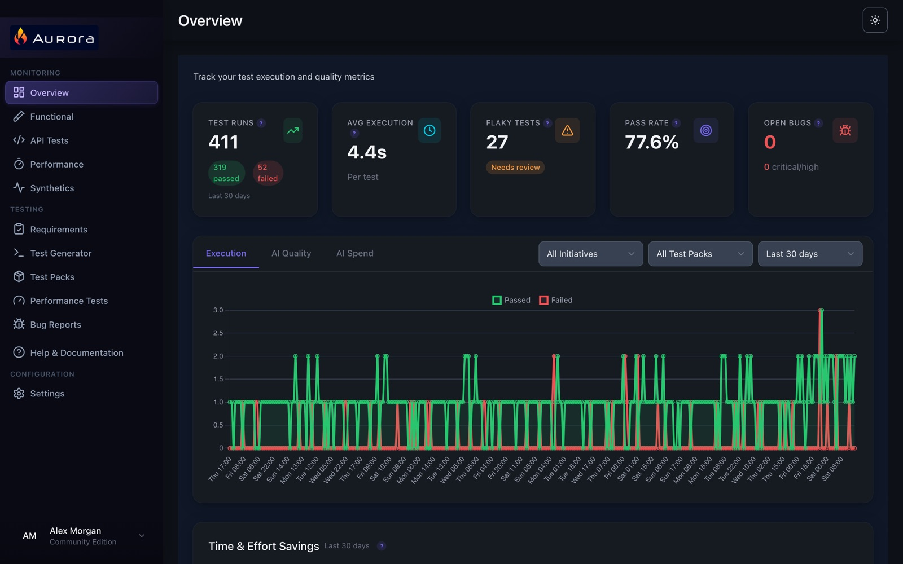
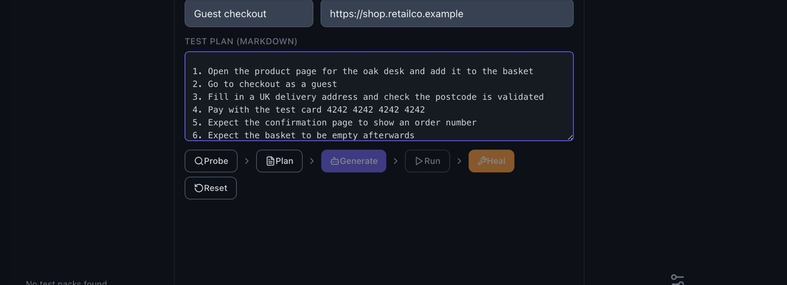
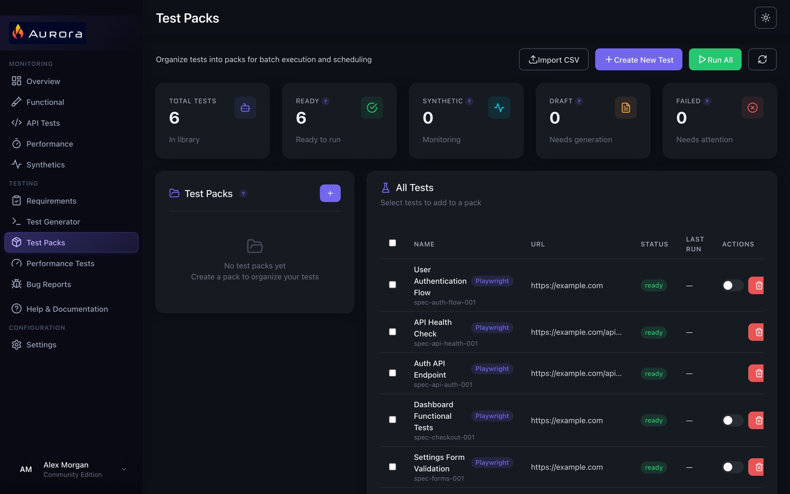

# Aurora Community Edition

**Write functional tests you can trust, then keep them watching production.** Aurora is a QA workbench: AI agents help you write Playwright tests for your web apps and APIs, you organise them into packs under the features and initiatives they prove, and any passing test can become a monitor. Pair it with [Continuum](https://github.com/selectred/continuum-community) to monitor your live services and collect every result, all inside your own network.

The Community Edition is free to use, including at work, and runs on your own machine with Docker. Nothing leaves it except the AI calls you configure.



## What it does

- **Test generation:** Probe → Plan → Generate → Run → Heal. Aurora's agents look at a page, plan the tests, write Playwright code, run it and repair what breaks. You review and edit everything.
- **API tests:** request-level tests for the services behind your UI, with shared variables and environments.
- **Test packs:** group tests and run them together, with failure evidence (screenshots, video, traces) and bug reports.
- **Synthetic monitoring:** make a passing test a monitor and choose how often it runs. Continuum runs it against your live service from inside your network and alerts your webhooks when it fails and when it recovers.
- **Traceability:** initiatives → features → test packs → tests. Results pushed to Continuum keep that chain.
- **Also, performance tests:** k6 scripts from HAR files, a scenario builder and runs of up to 20 virtual users, compared with a baseline you choose.
- **Your choice of AI:** Anthropic Claude, OpenAI, Azure OpenAI or a local model (for example Ollama). The keys are yours and stay in your installation.



## Quick start

You need Docker with Compose v2 (Docker Desktop, or Docker Engine on Linux) and about 4 GB of free memory.

```bash
git clone https://github.com/selectred/aurora-community.git
cd aurora-community
docker compose up -d --build
```

The first build downloads the Playwright browser image and takes a few minutes. Then open **http://localhost:8080**.

To use a different port, copy `.env.example` to `.env` and change `AURORA_PORT`.

### First steps

1. The setup wizard asks for your name and your AI provider. For a model running on the same machine (for example Ollama), use `http://host.docker.internal:11434` as the endpoint.
2. To look around with example data, go to **Settings → Backup / Data → Load Sample Data**.
3. Open **Test Generator**, give it a URL and press **Probe**.



## Connecting to Continuum

In Continuum, open **Settings → Team Management** and create an Aurora integration key for your team. In Aurora, open **Settings → Continuum Integration** and enter Continuum's address and that key. If Continuum is running in Docker on the same machine, its address is `http://host.docker.internal:8082`.

## Updating and backups

```bash
git pull
docker compose up -d --build
```

Your tests, results and settings are in the `aurora_data` Docker volume, so they survive updates. To back up, use **Settings → Backup / Data → Export**, or copy the volume.

## Good to know

- **Recording a journey** opens a browser window on the machine Aurora runs on. In Docker there's no screen to show it on, so write or generate tests instead.
- Aurora has no user accounts: it's meant for one person or a small team on a trusted network. Don't expose it to the internet.

## Community Edition and Select Red

The Community Edition is the whole of Aurora: every feature, with no limits and no licence key. You support it yourself through GitHub issues.

[Select Red](https://selectred.com/aurora) also offers, commercially:

- the signed desktop app for macOS and Windows,
- Continuum installed in your Kubernetes cluster with Helm,
- support, and consulting to get your test automation built and running.

## Licence

Aurora Community Edition is licensed under the [Elastic License 2.0](LICENSE) (ELv2).

In plain English: you can use it for free, including at work, and you can change it and share it. You can't offer it to others as a hosted or managed service, and you can't remove or change Select Red's licensing and copyright notices. If you share a modified version, say that you changed it. The [LICENSE](LICENSE) file has the full terms; this summary isn't legal advice. See also [NOTICE](NOTICE).

## Contributing and security

Issues are welcome; see [CONTRIBUTING.md](CONTRIBUTING.md). Please report security problems privately: see [SECURITY.md](SECURITY.md).
